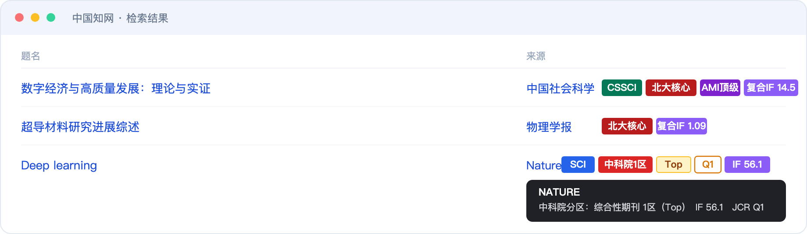

# 期刊等级助手 · JournalRank

[](https://github.com/Al0060215/journal-rank-extension/actions/workflows/test.yml)
[](https://github.com/Al0060215/journal-rank-extension/releases)

一个**完全免费、数据全部存在本地**的 Chrome 扩展：打开知网、谷歌学术、Web of Science 等学术网站，
它会在每篇论文旁边直接标出期刊等级 —— SCI / 北大核心 / CSSCI / 中科院分区 / 影响因子 / EI / CCF。

同类插件（比如 easyScholar）的核心功能要付费，而且查询要连它的服务器；这个项目把数据表整个塞进插件里，
**不联网、不登录、不限次数**。



---

## 一、能显示什么

| 徽章 | 含义 | 数据版本 |
|---|---|---|
| `SCI` `SSCI` `AHCI` `ESCI` | Web of Science 收录类型 | 中科院分区表 2025 |
| `中科院1区` ~ `中科院4区` + `Top` | 中科院文献情报中心期刊分区（大类） | 2025 升级版 |
| `Q1` ~ `Q4` | JCR 分区（取最好的学科分区） | JCR 2025 |
| `IF 12.3` / `复合IF 2.1` | 英文刊用 JCR 影响因子，中文刊用复合影响因子 | JCR 2025 / 万维书刊 |
| `EI` | Ei Compendex 收录 | 2019 版目录 |
| `CCF A/B/C` | 中国计算机学会推荐等级 | CCF 2026 |
| `北大核心` `CSSCI` `CSSCI扩展` | 中文核心体系 | 2023 / 2025-2026 |
| `CSCD` / `CSCD扩展` | 中国科学引文数据库 | 2025-2026 官方 |
| `科技核心` | 中国科技核心期刊（统计源期刊） | 2024 |
| `AMI` `国社科` `RCCSE` `T1-T4` | 其余中文评价体系 | 各版本 |
| `⚠ 预警` | 国际期刊预警名单 | 2023-2025 |

鼠标悬停在徽章上会弹出完整信息：大类/小类分区、学科排名、JCR 各学科分区、ISSN 等。

---

## 二、安装（约 1 分钟）

**方式一：直接下载（不用装 Node、不用克隆）**

去 [Releases](https://github.com/Al0060215/journal-rank-extension/releases) 下载最新的
`journal-rank-extension-v*.zip`，解压得到一个 `extension` 文件夹，然后走下面第 1~5 步。

**方式二：克隆仓库**

```bash
git clone https://github.com/Al0060215/journal-rank-extension.git
```

用克隆下来的 `extension` 文件夹，同样走下面第 1~5 步。

---

1. Chrome 地址栏打开 `chrome://extensions/`
2. 右上角打开 **开发者模式**
3. 点 **加载已解压的扩展程序**
4. 选择本项目里的 **`extension`** 文件夹（不是仓库根目录）
5. 随便打开一个知网检索页，论文标题/来源旁边出现彩色标签就成功了

不需要账号，不需要科学上网，不联网。

> 更新数据或改了代码后，回到 `chrome://extensions/` 点插件卡片上的「刷新」按钮即可。

---

## 三、支持的网站

| 网站 | 状态 | 说明 |
|---|---|---|
| 中国知网（kns.cnki.net） | ✅ 主力支持 | 检索结果「来源」列 + 文献详情页 |
| 知网空间（search.cnki.com.cn） | ✅ | 同上逻辑 |
| Google Scholar | ✅ | 标题下方的 "作者 - 期刊, 年份 - 站点" 行 |
| SpringerLink | ✅ | 结果列表的期刊名 |
| IEEE Xplore | ✅ | `.description` 里的出版物名 |
| ACM Digital Library | ✅ | 结果条目的期刊名 |
| Web of Science | ⚠️ 尽力而为 | 新版 JCR 悬浮层；页面结构变动频繁 |
| 百度学术 | ⚠️ 尽力而为 | 结果条目的期刊名 |
| 万方 / 维普 | ⚠️ 尽力而为 | 站点是 JS 渲染，选择器可能失效 |
| PubMed | ✅ | 摘要页读完整刊名；**列表页靠 NLM 缩写表还原**（`Nat Commun` → Nature Communications） |
| Elsevier / Wiley / Nature / ACS / MDPI 等 | ⚠️ 尽力而为 | 期刊页标题 |

任何网站都可以用 **右键手动查询**（见下），所以即使某个站点适配失效，功能也不会完全不可用。

### 校园网 WebVPN 也能用

国内高校普遍用深信服 SSL VPN 访问知网/谷歌学术，它会把域名改写成
`kns-cnki-net-s.vpn.sjtu.edu.cn` 这种形式（点换横线 + 加 `-s.vpn.<学校>` 后缀），
导致插件按域名匹配失效。

插件内置了**域名还原**逻辑：先把它还原成 `kns.cnki.net` 再判断站点，所以走 VPN 时同样能标注。
目前内置了上海交大（`*.vpn.sjtu.edu.cn`）的匹配规则；**换学校时**，只要在
`extension/manifest.json` 的 `content_scripts.matches` 里加一条你学校的 VPN 域名即可，例如：

```json
"*://*.vpn.xxx.edu.cn/*"
```

域名还原逻辑在 `extension/src/content/content.js` 的 `unVpnHost()`，适用于
`xxx-yyy-com-s.vpn.school.edu.cn` 这种编码方式。

---

## 四、三种用法

**1. 自动标注** — 打开上述网站即可，无需操作。

**2. 悬停看详情** — 鼠标移到徽章上，弹出大类/小类分区、学科排名、影响因子、ISSN。

**3. 导出本页论文（CSV）** — 标注完成后点插件图标，弹窗里会出现「导出本页 N 条（CSV）」。
导出内容：题名、期刊、收录类型、中科院大类/分区、Top、JCR、影响因子、EI、CCF、中文核心、预警。
文件带 BOM，Excel 直接打开不乱码。写文献综述时很省事。

**4. 右键手动查询** — 在**任意**网页选中一段期刊名 → 右键 → 「查询『xxx』的期刊等级」，
页面右下角会弹出结果卡片。适合知网之外的期刊官网、公众号文章、PDF 阅读器里的文字。

点浏览器工具栏的插件图标，可以：一键开关、勾选显示哪些标签、快速查一个刊名。

---

## 五、数据从哪来

全部是公开数据，构建时一次性合并进 `extension/src/data/journals.json`（约 5.8 MB）：

| 数据集 | 条数 | 说明 |
|---|---|---|
| 中科院分区表 2025（升级版） | 21,772 | 大类/小类分区、Top、OA、WoS 收录类型 |
| JCR 2025 | 22,643 | 影响因子、分区、学科排名 |
| **CSCD 2025-2026（官方 PDF）** | **1,504** | 核心库 1,120 + 扩展库 384 |
| **中国科技核心期刊目录 2024** | **2,632** | 自然科学卷 2,218 + 社会科学卷 414 |
| **NLM J_Medline 期刊缩写表** | **38,106 → 12,749 条映射** | 用来把 PubMed 的 `Nat Commun` 还原成全称 |
| Ei Compendex 目录 | 4,567 | EI 收录 |
| CCF 推荐目录 2026 | 681 | A/B/C 类 |
| 国际期刊预警名单 2023-2025 | 57 | 预警原因 |
| 中文核心体系 | 3,848 | 北大核心 2023、CSSCI 2025-2026、AMI 2022、国社科 2025、RCCSE、高质量科技期刊 |

合并后：**25,245 条国际期刊 + 4,830 条中文期刊**，其中 21,974 条带影响因子、21,771 条带中科院分区。

中文标签覆盖：科技核心 2,627、北大核心 1,975、CSCD 1,123（另扩展 384）、CSSCI 671（另扩展 263）、AMI 核心 636。

> 数据版权归各发布机构所有，本项目仅做个人研究用途的整合。原始 CSV 放在 `tools/raw/`，
> 每个文件的来源在 `tools/build-data.mjs` 开头有注释。

---

## 六、自己更新数据

原始表在 `tools/raw/`，替换成新版本后重新构建：

```bash
node tools/build-data.mjs
```

脚本会输出覆盖率统计和重名冲突数量。构建完成后回 `chrome://extensions/` 刷新插件。

如果你有更全的 **CSCD** 或 **科技核心** 名单（当前版本这两项偏向人文社科，理工类中文刊覆盖不全），
按同样的列名做成 CSV 放进 `tools/raw/`，在 `build-data.mjs` 里加一段合并逻辑即可。

重新生成图标：

```bash
node tools/make-icons.mjs
```

---

## 七、测试

两个测试，都不依赖 npm 包：

### 1. 匹配回归（秒级，无需浏览器）

```bash
node tools/check-match.mjs
```

构建索引、抽样 500 条国际刊 + 500 条中文刊验证命中率，再跑 18 个边界用例
（大小写、`The` 冠词、书名号、全角/半角括号、带别名后缀的刊名等）。

当前结果：国际刊 100%、中文刊 100%、边界用例全过；索引构建约 45 ms，单次查询 < 0.01 ms。

### 2. 端到端（真实浏览器）

```bash
node tools/test-e2e.mjs
```

会真正启动浏览器、加载插件、访问 `test/demo.html`（模拟知网 / 谷歌学术 / Springer 的 DOM 结构），
断言徽章内容，并冒烟测试设置页和弹窗。当前结果：

```
PASS  知网               组=3  缺徽章=无  缺期刊=无
PASS  Google Scholar     组=2  缺徽章=无  缺期刊=无
PASS  SpringerLink       组=2  缺徽章=无  缺期刊=无
PASS  设置页
PASS  弹窗
PASS  扩展后台
```

> **注意**：正式版 Google Chrome 从 137 起禁止了 `--load-extension`，只能用 Chrome for Testing 跑。
> 一行命令自动下载对应平台的版本：
>
> ```bash
> node tools/install-chrome.mjs
> ```
>
> 它会装到 `.cache/cft/`，测试脚本会自动找到。

测试原理：把 `content_scripts.matches` 临时改成 `http://*/*`（只改临时副本），
再用 `--host-resolver-rules` 把 `kns.cnki.net` 等域名指向本地服务器，
这样内容脚本判断域名的分支仍然走真实逻辑。

---

## 八、隐私

- **不发起任何网络请求**。所有查询都在本地 5.8 MB 的 JSON 里完成。
- **不上传任何数据**，不采集浏览记录。
- 只申请了 `storage`（存设置）、`contextMenus`（右键菜单）、`activeTab` + `scripting`（右键查询时往当前页注入浮窗）。
- 数据文件随插件打包，`fetch` 的是 `chrome-extension://` 本地地址，不出机器。

---

## 九、已知限制

1. **中文刊覆盖不是 100%** —— 北大核心 1,975（官方约 1,987）、CSCD 1,123 + 扩展 384、科技核心 2,627，
   主流期刊都覆盖了；但集刊、年鉴、内部刊物、新创刊仍可能查不到。
2. **科技核心是 2024 版** —— 官方 2025 版目录没找到公开下载。拿到后替换
   `tools/raw/kejihexin_2024.json` 重新构建即可。
3. **万方 / 维普 / Web of Science** 是 JS 重渲染的站点，选择器随时可能失效。
4. **同名期刊**：极少数期刊英文全称完全相同（如不同 ISSN 的 `AI`、`CC`），按名称查询时取第一条。
5. **NLM 缩写匹配**只覆盖已收录的 12,749 种期刊；PubMed 里很冷门的缩写仍可能查不到。
6. 徽章样式用 `!important` 强行覆盖站点 CSS，个别站点可能出现排版挤压。

---

## 十、目录结构

```
journal-rank-extension/
├── extension/                  ← 这个文件夹用于「加载已解压的扩展程序」
│   ├── manifest.json
│   ├── icons/                  (由 tools/make-icons.mjs 生成)
│   └── src/
│       ├── background/service-worker.js   懒加载数据、响应查询、右键菜单
│       ├── content/content.js             站点适配器 + 徽章渲染
│       ├── content/content.css            徽章样式
│       ├── shared/normalize.js            刊名归一化
│       ├── shared/index.js                索引构建 + 查询（后台与测试共用）
│       ├── popup/                         工具栏弹窗
│       ├── options/                       设置页
│       └── data/journals.json             合并后的期刊库（构建产物）
├── tools/
│   ├── build-data.mjs         合并原始数据 → journals.json
│   ├── check-match.mjs        匹配回归测试（无需浏览器）
│   ├── test-e2e.mjs           CDP 端到端测试（需要 Chrome for Testing）
│   ├── install-chrome.mjs     下载 Chrome for Testing（跨平台）
│   ├── package.mjs            打包成可发布的 zip
│   ├── make-icons.mjs         生成 PNG 图标（零依赖）
│   ├── lib/                   共用模块（Chrome 路径解析）
│   └── raw/                   原始数据表
├── test/demo.html             模拟各站点结构的测试页
└── docs/
    ├── prior-art.md           同类插件调研（easyScholar 等）
    └── screenshot-concept.png 效果示意图
```

---

## 十一、后续可以加什么

- [x] 用 NLM 缩写表打通 **PubMed 列表页**
- [x] 补全 **CSCD（官方 PDF）** 和 **科技核心**
- [x] 导出当前页论文等级为 **CSV**
- [ ] 科技核心 2025 版（等官方目录公开）
- [ ] 知网「期刊导航」页显示影响因子趋势
- [ ] 支持 Zotero（社区已有 CCF-Rank 之类的插件，可复用数据）
- [ ] 自建数据更新脚本：一键拉取最新 CSCD / JCR 并重建

---

## 十二、出问题了怎么查

先点一下工具栏的插件图标——弹窗顶部有一栏「**当前页面**」，它会直接告诉你卡在哪一步：

| 弹窗显示 | 含义 | 处理 |
|---|---|---|
| 🟢 已生效：中国知网 | 正常 | 页面上应该有标签了 |
| 🟢 已生效（手动注入） | 自动注入没生效，弹窗替你补了一刀 | 功能可用；若每次都要点，反馈一下 |
| 🟡 识别到期刊名，但没有匹配上 | 脚本在跑，是查库没命中 | 把弹窗里显示的刊名记下来，补数据 |
| 🟡 没提取到期刊名 | 站点改版，选择器失效 | 在 Console 里 dump 一行结果行的 HTML |
| 🔴 无法注入本页：原因 xxx | 权限或 URL 被拦 | 看后面那句话 |

### 三个已经踩过的坑

**1. 改了代码但页面没变化**
未打包扩展改了 `manifest.json` 后，光刷新网页没用。要么点 `chrome://extensions` 卡片上的 ↻，
要么**完全退出 Chrome（⌘Q）再打开**——后者最保险，Chrome 会缓存旧清单。

**2. 走校园 WebVPN 时完全不生效**
深信服 SSL VPN 会把 `kns.cnki.net` 改写成 `kns-cnki-net-s.vpn.sjtu.edu.cn`，
域名里没有 `cnki.net`，所有匹配规则落空。插件已内置域名还原（`unVpnHost()`）。
**换学校**时需要在 `extension/manifest.json` 里补一条你学校的 VPN 域名：

```json
"*://*.vpn.你的学校.edu.cn/*"
```

**3. 控制台里 `document.documentElement.dataset.jrInjected` 是 `undefined`**
说明内容脚本压根没注入。返回 `"cnki"` 才是注入成功。
用这一行可以在任何页面快速自检。

### 还是不行的话

在出问题的页面按 `⌥⌘I`，Console 里跑：

```js
console.log('注入标记:', document.documentElement.dataset.jrInjected);
console.log('当前网址:', location.href);
console.log('徽章数:', document.querySelectorAll('.jr-badges').length);
console.log('候选行数:', document.querySelectorAll('td.source').length);
```

把四行输出发出来，基本就能定位。

---

## 十三、数据版权与免责声明

**代码**以 [MIT](LICENSE) 协议开源。

但 `tools/raw/` 里的原始数据表和 `extension/src/data/journals.json`（构建产物）**不属于 MIT 协议范围**，
其版权归各发布机构所有，包括但不限于：

| 数据 | 版权 / 发布方 |
|---|---|
| JCR 影响因子、分区 | Clarivate Analytics |
| 中科院期刊分区表 | 中国科学院文献情报中心 |
| CSCD 来源期刊目录 | 中国科学院文献情报中心 / sciencechina.cn |
| 中国科技核心期刊目录 | 中国科学技术信息研究所 |
| Ei Compendex 收录目录 | Elsevier |
| 北大核心 / CSSCI / AMI / 国社科 等 | 各目录的发布单位 |
| NLM 期刊缩写表 | 美国国家医学图书馆（公共领域） |

本项目对上述数据的使用**仅限于个人学习与研究目的的整合**，不构成任何商业授权。
如需商用，请自行向相应机构申请许可。

如果你认为本仓库的内容侵犯了你的权益，请提交 issue 或通过仓库主页联系作者，我会立即删除相关内容。

> 提醒：因为这些数据会被浏览器扩展打包进本地文件，**只在本地使用**没有问题；
> 但把它当作产品分发（尤其是收费），需要另行取得授权。
